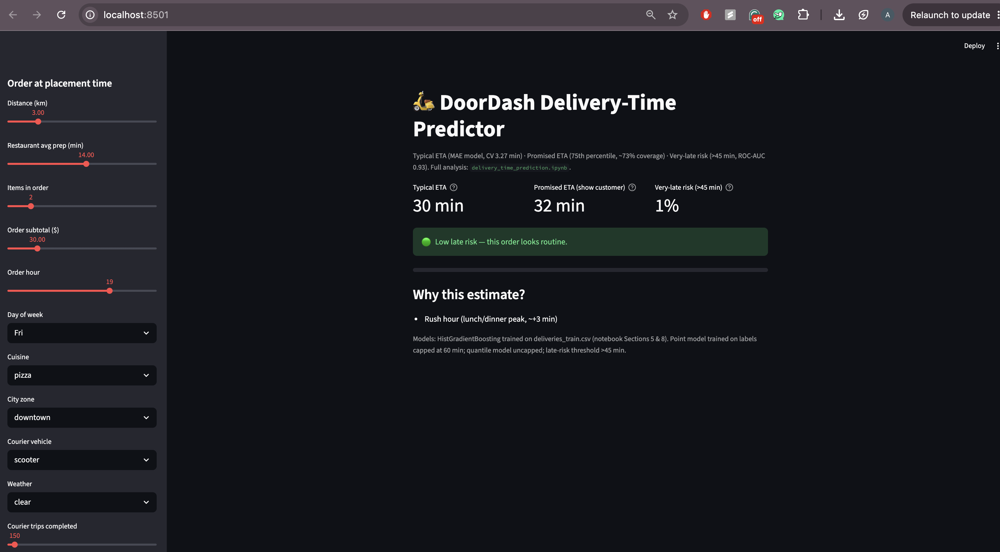
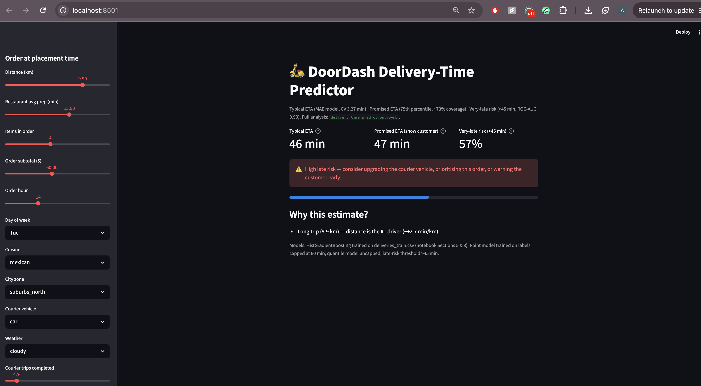

# DoorDash Delivery-Time Prediction

Predicting food delivery time (in minutes) from information known **at the moment an order is placed** — and explaining what makes deliveries slow.

DoorDash's baseline estimate is a flat average that is often far off, and late deliveries lead to refunds and bad reviews. This project builds, honestly evaluates, and interprets a model that replaces that flat estimate, then predicts delivery times for 2,000 held-out test orders.

> **Result:** 5-fold cross-validated **MAE of 3.27 minutes**, vs **7.73 minutes** for a flat-average baseline — a **58% improvement**.

---

## Results

| Model | CV MAE (minutes) |
|---|---|
| Baseline — predict the training median for every order | 7.73 |
| Ridge Regression (linear) | 3.37 |
| Random Forest (200 trees) | 3.48 |
| **HistGradientBoosting (final model)** | **3.27** |

- Validation: shuffled 5-fold cross-validation, always scored with MAE against the **original, uncapped** delivery times. A chronological split (train on the first 80% by date → test on the last 20%) gives MAE 2.93 vs 7.51 for the baseline, confirming no temporal drift is being exploited.
- On normal orders (actual ≤ 60 min) the model's typical error is **~2.8 minutes**.

## What makes deliveries slow?

From permutation importance and partial-dependence analysis of the final model, in order:

1. **Distance** — the dominant factor (~+2.7 min per km; 1 km → ≈24 min total, 11 km → ≈51 min)
2. **Restaurant prep time** — a 22-min-prep restaurant takes ≈18 min longer than a 6-min-prep one
3. **Courier vehicle** — bikes are ~3 min slower than scooters at equal distance
4. **Rush hour** — lunch (11–13) and dinner (18–20) peaks add ~3.3 min
5. **Weather × distance** — heavy rain adds ~4.8 min, growing with distance
6. **Basket size** — 8 items take ~5 min longer than 1 item
7. **Courier experience** — couriers with 1,000+ trips are ~2 min faster than novices

Note: `city_zone` and `cuisine` appear weak individually only because their information is already carried by distance and prep time respectively.

## Approach

The full analysis lives in a single notebook, [`delivery_time_prediction.ipynb`](delivery_time_prediction.ipynb):

1. **Exploration** — target distribution, missing values, and how every feature relates to delivery time.
2. **Data-quality handling**
   - *Freak-delay tail:* 98.9% of deliveries finish within 60 min, yet the maximum is 139 min. Orders over ~60 min are feature-identical to normal orders (accidents/breakdowns — unpredictable at order time), so training labels are **winsorised at 60 min** while evaluation always uses the true labels. This improved CV MAE from 3.46 → 3.27 and is corroborated by a median-loss model with no capping (MAE 3.268).
   - *Logging errors:* `courier_trips_completed` (median 147, max 45,151) is clipped and log-transformed.
   - *Missing values* (`weather` ~3%, `courier_trips_completed` ~4%): median / `"unknown"` imputation plus missingness indicators, fitted **inside each CV fold**.
3. **Leakage control** — only placement-time information is used. `restaurant_id` is deliberately excluded: every restaurant maps 1-to-1 to a single (cuisine, zone, prep-time) triple, so the ID adds only memorisation (an ablation confirmed it *hurt* CV MAE).
4. **Feature engineering** — hour/day-of-week, lunch/dinner rush flags, cyclical hour encoding, and physical interactions: `distance × weather severity`, `prep time × items`, `distance²`, `subtotal per item`, `log courier trips`.
5. **Modelling** — baseline, Ridge, Random Forest, and HistGradientBoosting compared under identical features and folds; HistGradientBoosting (lr 0.03, 300 iterations, 15 leaves, L2 = 1.0) selected.
6. **Interpretation & error analysis** — permutation importance, partial-dependence effects, and segment-wise errors. The ~1% freak-delay orders contribute 17% of total error and cannot be foreseen from placement-time data, so the report recommends a high-quantile (e.g. 75th-percentile) customer-facing estimate rather than a mean-case one.
7. **Prediction** — the final model is retrained on all 8,000 training orders and writes `predictions.csv` for the 2,000 test orders (range 13.5–63.0 min, mean 31.6).

## Demo — Streamlit App (`app.py`)

Enter an order in the sidebar and get the typical ETA, the promised (75th-percentile) ETA, the very-late risk, and the reasons behind the estimate.

**A routine order** — short trip, average kitchen, Friday dinner hour: 30 min typical ETA, 32 min promise, 1% late risk.



**A risky order** — 9.9 km to the northern suburbs at lunch: 46 min typical ETA, 57% chance of exceeding 45 min, so the app recommends upgrading the courier vehicle, prioritising the order, or warning the customer early.



Run it yourself: `streamlit run app.py` (see [How to Run](#how-to-run)).

## Beyond the Point Prediction (Section 8 of the notebook)

The deliverable is a small system, not a single number:

| Component | Result | Purpose |
|---|---|---|
| **Quantile model (75th percentile)** | 73.3% coverage out-of-fold at only +1.7 min average quote | The ETA promised to customers — ~3 of 4 deliveries arrive by it |
| **Very-late-risk classifier** (>45 min) | ROC-AUC 0.934, PR-AUC 0.774; at threshold 0.5: 79% precision, 60% recall, flags 6% of orders | Lets operations intervene at placement (upgrade vehicle, prioritise, warn customer) |
| **SHAP explanations** | Global ranking agrees with permutation importance (distance ≫ prep > rush/bike); per-order attributions | Explains *why this ETA* for any single order |
| **Restaurant target encoding** | CV MAE 3.299 vs 3.271 without | ❌ **Tested leakage-safely and rejected** — adds nothing beyond prep/cuisine/zone; kept in the notebook as an honest negative result |

The point model — and therefore `predictions.csv` — is unchanged: none of the enhancements beat it at its own job.

## Repository Structure

```
delivery-time-prediction/
├── delivery_time_prediction.ipynb   # Complete analysis (EDA → modelling → explanation → prediction)
├── app.py                           # Streamlit demo: order in → ETA, promise, late-risk, reasons
├── assets/                          # Streamlit demo screenshots used above
├── deliveries_train.csv             # 8,000 labelled orders
├── deliveries_test.csv              # 2,000 orders to predict
├── predictions.csv                  # Model output: order_id, predicted_minutes
└── README.md
```

## How to Run

> **Use one consistent Python environment for everything.** The notebook and the demo both need `pandas`, `scikit-learn`, `matplotlib`, `shap` (notebook only), and `streamlit` (demo only). If you have multiple virtual environments on your machine, a bare `streamlit run app.py` may pick up a `streamlit` binary from a *different project's* venv that lacks scikit-learn — the app then fails with `ModuleNotFoundError: No module named 'sklearn'`. Avoid this by either activating the environment first or launching through an explicit interpreter path (both shown below; explicit paths are foolproof).

### Setup

```bash
cd delivery-time-prediction
pip install pandas numpy scikit-learn matplotlib jupyter shap streamlit
```

### 1. Full analysis (reproduces every result, regenerates `predictions.csv`)

```bash
jupyter notebook delivery_time_prediction.ipynb
```

Run the notebook cells top to bottom; the final cell regenerates `predictions.csv` in the same directory.

### 2. Interactive demo

Activate your environment first, **or** call Streamlit by its full path inside that environment:

```bash
# Option A — activate, then run
source /path/to/your/venv/bin/activate
streamlit run app.py

# Option B — explicit interpreter path (no activation needed; adjust to your venv location)
"/path/to/your/venv/bin/streamlit" run app.py
# e.g. on the author's machine:
# "/Users/ameyakhond/Desktop/Personal Project/.venv/bin/streamlit" run app.py
# /Users/ameyakhond/anaconda3/bin/streamlit run app.py        # Anaconda also works (has sklearn + streamlit + shap)
```

Then open http://localhost:8501. Enter an order in the sidebar (distance, prep time, items, hour, vehicle, weather, …) to see the typical ETA, the promised (75th-percentile) ETA, the very-late risk with an intervention warning, and the top reasons behind the estimate. The demo trains the three models on `deliveries_train.csv` on first load and caches them afterwards.

### Troubleshooting

| Symptom | Cause & fix |
|---|---|
| `ModuleNotFoundError: No module named 'sklearn'` when launching the app | The `streamlit` on your PATH belongs to a different project's venv (check the traceback — it shows which venv's `streamlit` ran). Re-launch with Option A or B above so the app runs in an environment that has scikit-learn. |
| `ModuleNotFoundError: No module named 'shap'` in the notebook's SHAP cell | Install it into the *same* environment that runs the notebook: `pip install shap`, or select that environment's kernel in Jupyter. |
| Notebook runs but `predictions.csv` isn't where you expect | The notebook writes it to its own working directory — launch Jupyter from inside this folder so paths resolve next to the CSVs. |

## Data

Each order includes: `order_placed_at`, `restaurant_id`, `cuisine`, `restaurant_avg_prep_minutes`, `city_zone`, `distance_km`, `items_count`, `order_subtotal`, `courier_vehicle`, `courier_trips_completed`, `weather`, and (train only) the target `delivery_minutes`. Orders span March–August 2025; train and test are randomly interleaved over the same period with no overlapping order IDs and no unseen categories in test.

## Limitations & Future Work

- Weather is recorded at placement; in production only a *forecast* would be available, adding noise.
- No live signals (restaurant's current load, courier's in-flight orders, real-time traffic) — the biggest realistic lever for further gains.
- A MAE-optimal point model will always under-predict freak delays; this is now mitigated (not solved) by the q75 promise model and late-risk classifier above. Live signals and a scheduled retraining/drift-monitoring pipeline are the natural next steps.
- Validation is within a single Mar–Aug 2025 regime; seasonal drift should be monitored in production.

## Tech Stack

Python · pandas · NumPy · scikit-learn · Matplotlib · SHAP · Streamlit · Jupyter
